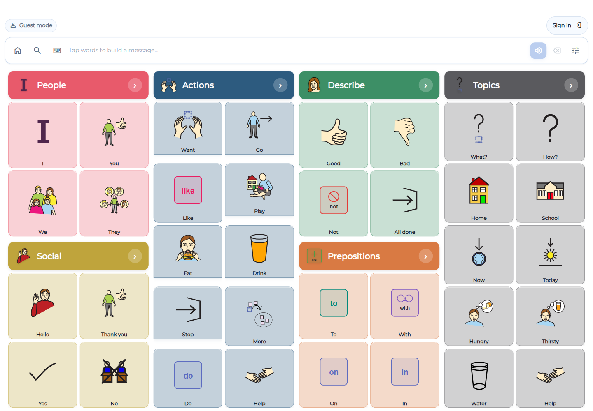
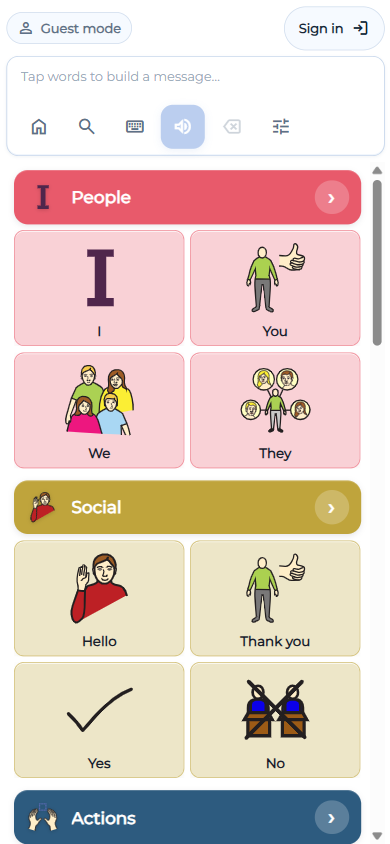
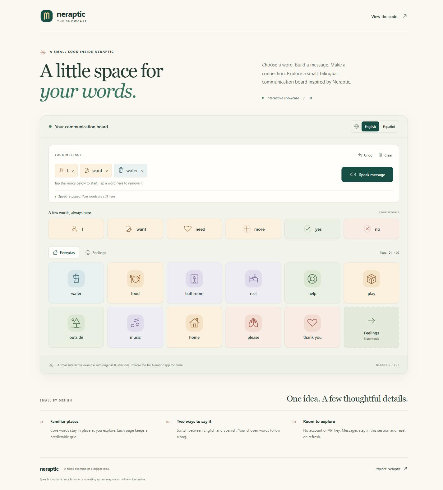

# Neraptic

**A communication board that turns selected words into spoken messages.**

Neraptic is a web application for augmentative and alternative communication (AAC). People can explore a visual vocabulary, compose a message, and speak it aloud. This repository presents the product, explains selected engineering decisions, and includes a small, runnable example of the core interaction.

[Try the sample](https://eduardolex.github.io/neraptic-showcase/) · [Open the full app](https://neraptic.com/neraptic-aac/guest) · [Run locally](#run-the-sample) · [Architecture](docs/architecture.md) · [Engineering decisions](docs/engineering-decisions.md)



*The full application's guest interface. The standalone example below is a separate implementation with a smaller vocabulary.*

## The product

The central interaction is deliberately direct: select words, build a message, and use speech playback. Colored vocabulary groups and linked board pages organize the available words. The interface adapts to different screen sizes while keeping the message composer close to the board.

The full application combines a React and TypeScript frontend with Vite, browser and Piper speech, account-based board storage through Supabase, Stripe billing, and a server-side pictogram generation integration with FAL. This public repository focuses on the communication-board experience and the engineering behind it.

Built by [@Eduardolex](https://github.com/Eduardolex).

## What this demonstrates

- **Board modeling:** typed word, page-link, and empty cells form a navigable graph. Empty or unresolved cells retain their slots so neighboring words keep their order.
- **Interaction design:** vocabulary selection, message composition, navigation, and speech form one continuous flow.
- **Localization:** the full app has English, Spanish, French, Arabic, Portuguese, and Hindi locale definitions, including right-to-left metadata for Arabic. The sample includes English and Spanish.
- **Speech coordination:** the full app manages browser speech and local Piper synthesis, with voice selection, warmup, caching, and cancellation. The sample demonstrates browser speech.
- **Clear application boundaries:** guest interaction runs without an account; account storage, subscriptions, and pictogram generation belong to the full application.

<table>
  <tr>
    <td width="32%"></td>
    <td width="68%"></td>
  </tr>
  <tr>
    <td>Full app · mobile guest view</td>
    <td>This repository · runnable sample</td>
  </tr>
</table>

## Run the sample

Use Node.js 22.12 or newer and npm. No account, API key, or environment file is needed.

```sh
git clone https://github.com/Eduardolex/neraptic-showcase.git
cd neraptic-showcase
npm install
npm run dev
```

On Windows PowerShell, use `npm.cmd` if your execution policy blocks `npm.ps1`.

Open the local URL printed by Vite. Six core words stay available while you navigate the **Everyday** and **Feelings** pages. Each page has eleven words and a link to the other page.

Choose **I**, **want**, and **water**, then select **Speak**. Switch to Spanish to relabel the board and the current message. Select a message chip to remove it, use **Clear** to start again, and **Undo** to reverse an edit. Messages have a 24-word limit, and Undo retains up to 50 edits.

The sample keeps state in memory. Refreshing resets the message, language, and page; no messages or preferences are saved.

```sh
npm test
npm run build
```

The tests cover composer transitions, the message limit, undo history, board slots, language changes, and voice matching. The production build also checks TypeScript, including the JavaScript domain model through JSDoc types.

Browser speech depends on the browser, operating system, and installed voices. The visual board and composer remain usable when speech is unavailable. Browser-provided voices may use an online service; this example does not promise offline speech.

## Sample and full-app scope

| Area | Runnable sample | Full Neraptic application |
| --- | --- | --- |
| Vocabulary | Small demonstration vocabulary | Larger categorized vocabulary and board tools |
| Boards | Six core words and two linked 12-slot pages | Section and grid pages; board builder |
| Languages | English and Spanish | Six locale definitions |
| Speech | Browser speech synthesis | Browser speech and Piper for supported locales |
| Accounts | None | Supabase authentication and account data |
| Payments | None | Stripe subscription integrations |
| Pictograms | Original inline SVG symbols | Existing symbol assets and FAL generation integration |

The current full-app guest route uses transient board state and browser speech. It does not save a guest draft or migrate one into an account. Signed-in storage and the repository's sample behavior are separate concerns.

## Explore the code

```text
neraptic-showcase/
├── README.md
├── docs/
│   ├── architecture.md
│   └── engineering-decisions.md
├── screenshots/
└── examples/
    └── aac-board/
```

For implementation, start with [`model.js`](examples/aac-board/src/model.js) for board data and the composer reducer, [`App.tsx`](examples/aac-board/src/App.tsx) for the interface, and [`useSpeech.ts`](examples/aac-board/src/useSpeech.ts) for browser speech.

Start with the [architecture walkthrough](docs/architecture.md) for the data flow, then the [engineering decisions](docs/engineering-decisions.md) for the reasoning and tradeoffs. Production source paths in those documents are references to the full application's codebase; the production source itself is not included here.

This is a portfolio case study and a focused code example. See [screenshot sources and artwork credits](screenshots/README.md).
