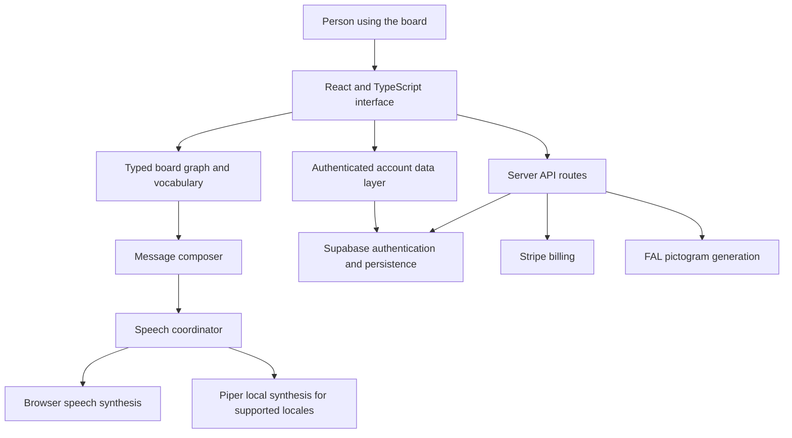
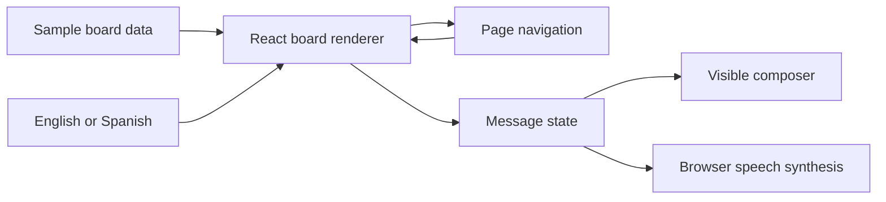

# Architecture

Neraptic's core flow is **board navigation → word selection → message composition → speech**. The full application adds account storage and supporting services around that interaction. The runnable sample in this repository isolates the board, composer, and browser speech so the flow can be inspected without configuring a backend.

## Full application



This diagram describes the full application's code structure. The guest route bypasses account persistence and uses browser speech. Service integrations in the diagram are not dependencies of the public sample.

### Board data is separate from rendering

A dynamic board has a root page ID and a collection of pages. Pages contain either grouped sections or a flat grid. Each cell describes one of three possibilities:

```ts
type BoardCell =
  | { kind: "word"; wordId: string }
  | { kind: "link"; pageId: string; label?: string }
  | { kind: "empty" };
```

This abbreviated shape illustrates the production model; the full type also supports presentation metadata on page links.

Words are resolved by ID through a map. A missing word or destination becomes an empty cell. Resolution uses `map`, preserving the number and order of the page's slots. A navigation stack records the current page and supports returning to previous pages.

The section renderer provides quick-access words grouped under category headers. Selecting a header opens a detail page. The grid renderer handles individual words, page links, and empty slots.

Dynamic-board search uses a separate result grid. Clearing the search restores the current board page. This allows global vocabulary search without rewriting the page's slot arrangement.

Production references:

- `src/features/paid-aac/types.ts`
- `src/features/paid-aac/dynamicBoards.ts`
- `src/features/paid-aac/components/AacDynamicGrid.tsx`
- `src/features/paid-aac/components/AacSectionPage.tsx`
- `src/pages/PaidAAC.tsx`

### Text and speech have different responsibilities

Locale data resolves word labels, category names, interface strings, text direction, and speech-language metadata. Production declares English, Spanish, French, Arabic, Portuguese, and Hindi. Word IDs remain stable across those translations.

The speech coordinator chooses and controls playback independently of the board renderer. The current implementation supports browser speech and Piper synthesis. Piper voices are defined for English, Spanish, French, Arabic, and Portuguese; Hindi uses browser speech. Neural voice models require downloading before local synthesis can run.

Piper session creation is shared between warmup and playback. Audio caching has entry, byte, and time limits, and object URLs are revoked when entries are removed. Playback coordination and cancellation prevent older asynchronous work from taking over a newer request.

Production references:

- `src/features/paid-aac/i18n.ts`
- `src/features/tts/useManagedTts.ts`
- `src/features/tts/piper.ts`
- `src/features/tts/client.ts`

### Guest and account flows share a board interface

`GuestAAC` renders the same `PaidAAC` interface with `guestMode` enabled. That flag selects browser-only speech and skips the account hydration, synchronization, and usage-persistence paths. Guest interaction state is transient. Older guest storage and migration utilities present elsewhere in the codebase do not describe the current guest route.

For signed-in flows, the account data layer represents board contents, settings, saved boards, sessions, and subscription state. Server API routes handle billing and pictogram service calls. These capabilities depend on configured services and are documented here as production architecture, not runnable sample features.

Production references:

- `src/pages/GuestAAC.tsx`
- `src/pages/PaidAAC.tsx`
- `src/features/paid-aac/api.ts`
- `api/billing/checkout.js`
- `api/billing/portal.js`
- `api/billing/webhook.js`
- `api/pictogram.js`

## Public sample



The sample lives in `examples/aac-board`. Six core words are always available. Everyday and Feelings each contain twelve ordered slots: eleven word cells and one navigation cell. These sample pages are fully populated; production's explicit empty-cell handling is described above.

The composer stores stable word IDs. Switching between English and Spanish relabels both the board and the existing message. A pure reducer handles additions, chip removal, clearing, and undo, retaining at most 50 edits and limiting the current message to 24 words. The domain model is JavaScript with JSDoc types checked by TypeScript, allowing the same module to run directly in Node's test runner.

The React interface uses TypeScript. Browser speech is invoked from a user action, with locale-matched voice selection and status messages for missing voices or unsupported speech. All state is in memory and resets on refresh.

| Sample source | Responsibility |
| --- | --- |
| [`src/model.js`](../examples/aac-board/src/model.js) | Vocabulary, board slots, reducer, message labels, voice matching |
| [`src/App.tsx`](../examples/aac-board/src/App.tsx) | Board, message composer, navigation, language selection |
| [`src/useSpeech.ts`](../examples/aac-board/src/useSpeech.ts) | Browser speech lifecycle |
| [`src/Icon.tsx`](../examples/aac-board/src/Icon.tsx) | Original inline SVG symbols |

There is no account session, database connection, subscription check, remote generation request, or Piper model download in the sample. Production images and screenshots are documentation assets; they are not a hidden dependency on production services.
